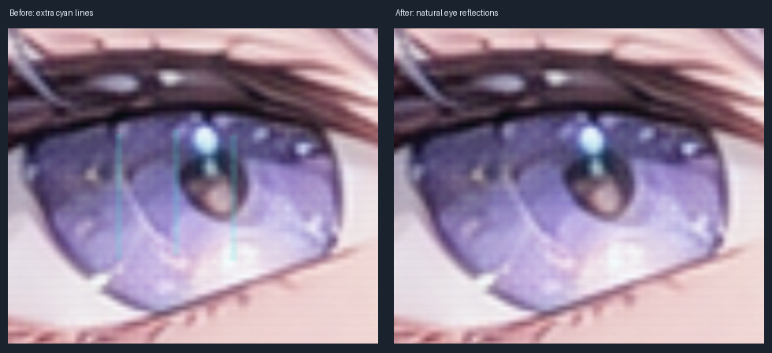
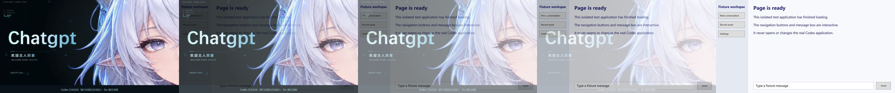

# 验证记录

本页区分当前眼部修复、既有功能验证与历史仓库整理检查。公开摘要不含本机用户名、绝对项目路径、PID、聊天截图或登录项；原始报告在项目外本地归档中保留。

## 2026-10-13 眼部修复版本

删除 `PaintEyes` 额外绘制的三条青色竖线，保留原素材的眼部反光、圆形柔光和眨眼。已重新渲染并部署正式 MP4、新版动画 EXE 与预览图；后台监视器、启动配置及欢迎语 WAV 保持原有哈希。

本轮结果与部署哈希见 [眼部修复验证摘要](docs/eye-highlight-fix-validation.json)。已实际执行：

- 同一时刻的旧版/新版 2560×1440 离屏画面相比，1558 个像素改变，眼睛范围外差异为 0；编码后的 7.75 秒关键帧也已目视复核。
- 片尾现有 5 项检查通过：眨眼、文字光点、发束动效、减少动画与计时器释放；面部、耳朵、角及文字布局仍固定。
- 页面提前就绪、延后就绪及减少动画共 3 项片头/交接回归通过。
- 启动集成 10 项检查通过，覆盖视频缺失或损坏、超时、单实例与预览隔离。
- 淡出屏幕采样的 6 项检查通过：采样 136 帧、约 39.01 fps，发现 10 帧中间透明状态，实测淡出约 0.463 秒，没有采样到黑帧。最大采样间隔约 70.56 ms，结论限定于该采样环境。
- 正式视频全量解码通过，保持 2560×1440、60 fps、480 帧、8 秒；音频仍由独立 WAV 播放。

本轮未重跑下述全部 90 项检查；新版本的证据以上述实际执行范围为准。真实官方图标冷启动及注销/重新登录未在本轮测试，也没有结束真实 Codex 会话。

## 2026-10-12 功能验证基线

2026-10-12 的部署验证通过 **90 项检查**，其中 84 项软件检查、6 项屏幕采样检查。结果与正式二进制哈希记录在 [公开验证摘要](docs/validation-snapshot.json)。

| 套件 | 检查数 | 覆盖内容 |
| --- | --- | --- |
| 完整片头与淡出 | 9 | 页面提前/延后就绪、内容消失、声音缺失/关闭/零音量、减少动画、淡出期间跳过 |
| 声音与覆盖窗口 | 7 | 片头下限、提前就绪、超时、重复关闭、声音结束后的等待 |
| 页面检测 | 8 | 空白/加载画面与模拟主页面的判定、检测释放 |
| 启动集成 | 10 | 并行启动、视频缺失/错误、超时、单实例、预览隔离 |
| 后台监视 | 15 | 模拟官方入口、窗口基线、子进程归并、重新待命、观察模式音效 |
| 音效组件 | 24 | PCM、音量、时钟、迟到对齐、静音降级、淡出和释放 |
| 监视器音频输出 | 11 | 模拟启动触发一次音轨、跨过 7.75 秒边界、自然结束后的音频会话信号 |
| 屏幕淡出 | 6 | 透明中间帧、窗口交接、抽样黑帧与绘制时序 |

模拟页面的屏幕采样实际约 40.83 fps、最大间隙约 33.29 ms；共 143 帧，发现 11 帧中间透明状态，实测淡出约 0.463 秒，没有采样到黑帧。此结论限定于该采样、设备和显示环境。

观察模式的 Codex 激活请求数为 **0**。验证没有强制结束真实 Codex，也没有修改 Windows 全局音量。

## 仓库整理检查

2026-10-12 的整理没有修改当时的正式 EXE、WAV、PNG、MP4、启动配置和保存的窗口几何。源码包与 Windows 运行包通过独立清单生成，排除本机状态、历史备份和测试生成物。

该次整理的公开结果见 [打包检查摘要](docs/package-validation.json)：包含脚本解析、隔离编译、当时所保留媒体的哈希核对、ZIP 清单以及模拟测试结果。该摘要不替代当前版本的验证。

## 仍需交互式验收

- 结束当前会话后，从真实官方图标进行完整冷启动体验验收。
- 注销/重新登录、混合 DPI、多显示器与显示器热拔插场景未在本次整理中重新测试。
- 页面已画出且窗口响应，不证明所有网络或后台任务已完成。
- 音频会话信号有输出，不证明扬声器设备的主观听感。
- 不同 GPU、Windows 媒体解码器和新版 Codex 可能有不同的窗口取图行为。

## 复核方式

在隔离副本构建后，按 [开发说明](docs/DEVELOPMENT.md) 顺序运行所需测试。不要并行运行共享动画单实例锁的套件，也不要用真实 Codex 进程作故障注入目标。
